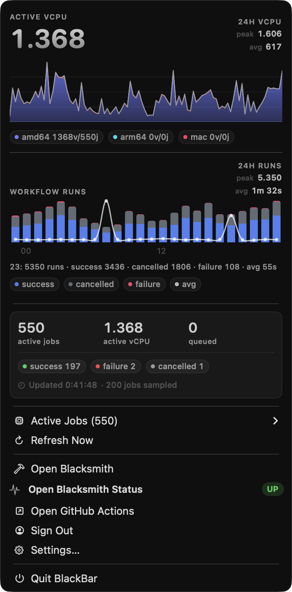

# BlackBar ⚒️ — The forge at a glance

[](https://github.com/steipete/BlackBar/actions/workflows/ci.yml)
[](https://github.com/steipete/BlackBar/releases/latest)
[](#install)
[](LICENSE)
[](https://github.com/steipete/homebrew-tap/blob/main/Casks/blackbar.rb)
[](https://black.bar)


BlackBar is a native macOS menu bar app for people who use Blacksmith CI. It shows service health, current runner load, and active jobs without keeping the dashboard open.

> [!IMPORTANT]
> BlackBar is an independent third-party tool. It is not affiliated with, sponsored by, or endorsed by Blacksmith.

<p align="center">
  
</p>

## Install

BlackBar requires macOS 14 or later. Install the signed app with Homebrew:

```sh
brew install --cask steipete/tap/blackbar
```

Alternatively, download `BlackBar-*.zip` from the [latest GitHub release](https://github.com/steipete/BlackBar/releases/latest), unzip it, and move `BlackBar.app` to `/Applications`.

## Quick start

Launch BlackBar:

```sh
open -a BlackBar
```

Then click its menu bar item, choose **Login with GitHub**, and finish the Blacksmith sign-in in the WebKit window. The app has no Dock icon.

The Blacksmith session cookie is stored in macOS Keychain and cached in memory while the app is running. **Sign Out** removes it.

## What it shows

- Blacksmith service health from the [public status feed](https://status.blacksmith.sh/).
- Current and historical vCPU use, job counts, and queued work.
- Active job details and `amd64`, `arm64`, and `macos` usage.
- Optional notifications for status changes, incidents, and completed jobs.
- Job completion notifications require an observed finished status; missing jobs and failed refreshes keep the last known state.
- PNG export for the usage and workflow graphs from their context menus.

Use **Settings…** to select a GitHub organization, filter to one repository, change the refresh interval, enable notifications, or launch BlackBar at login. Fresh settings use the `openclaw` organization, include every visible repository, refresh every 60 seconds, and leave notifications off.

## Data and privacy

BlackBar requests public health data from `status.blacksmith.sh` and authenticated usage data directly from Blacksmith's dashboard API. The signed app uses a GitHub-hosted Sparkle feed and GitHub Releases for updates, and user actions can open Blacksmith or GitHub pages.

There is no BlackBar-operated proxy or backend, and the app includes no analytics or crash-reporting service. See [VISION.md](VISION.md) for the project's product and privacy principles.

## Development

Building requires macOS 14 or later and a Swift 6 toolchain.
CI uses the Apple Silicon macOS 27 `xcode-27` image with Xcode 27 and retains
the macOS 14 deployment target. Release verification launches both universal
binary architectures, using Rosetta for x86_64.

```sh
make ci    # tests, release build, and app bundle
make app   # assemble build/BlackBar.app
```

The executable target lives in `Sources/BlackBar/`; bundle metadata and artwork live in `Resources/` and `Assets/`. The static site at [black.bar](https://black.bar) lives in `docs/`.

Maintainers can follow the [release procedure](docs/releasing.md) for signing, notarization, Sparkle, and GitHub Releases.

## Trademark notice

"Blacksmith" and the Blacksmith logo are trademarks of their respective owners. Questions about the name can be sent to [steipete@gmail.com](mailto:steipete@gmail.com) or opened as an issue.

## License

[MIT](LICENSE) © Peter Steinberger.
